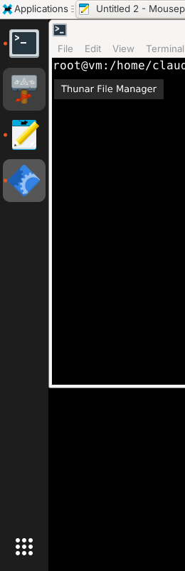

# Dockling

An ultra-lightweight, Ubuntu-style application dock for X11 desktops, written in Rust.
Built for XFCE on Debian 13, it works with any EWMH window manager (xfwm4, Openbox, ...).



- **Tiny**: a single ~2 MB binary using about 5 MB of RAM, no GTK/Qt, no D-Bus, no GPU.
  It sleeps until X sends an event (0% CPU when idle).
- **Ubuntu-like**: pinned launchers, running apps with one dot per window, focused-app highlight,
  "Show Applications" grid button, tooltips, right-click menu (New Window, Pin/Unpin, Quit).
- **Smart clicks**: click to launch or focus, click again to minimize (or cycle between windows),
  middle-click for a new window, scroll to switch between an app's windows.
- **Screen space**: reserves its edge so maximized windows stay clear; fits between existing XFCE panels.
- **Autohide** (optional), left/right/bottom/top position, full-length or centered.
- **Transparency and rounded corners** when a compositor runs; solid colors otherwise (ideal for VNC/noVNC).
- **Configurable** with a single commented TOML file; changes apply live with `dockling --reload`.
- Icons from your icon theme (PNG and SVG), falling back to the window's own icon.

## Install on Debian 13 (trixie)

Debian 13 ships Rust 1.85; Dockling needs Rust 1.88 or newer, so install the current stable toolchain with rustup:

```sh
sudo apt install -y build-essential curl git
curl --proto '=https' --tlsv1.2 -sSf https://sh.rustup.rs | sh -s -- -y --profile minimal
. "$HOME/.cargo/env"

git clone https://github.com/alexandreravelli/dockling.git
cd dockling
cargo build --release
sudo make install        # /usr/local/bin/dockling + autostart for every user
```

Log out and back in (or run `dockling &`) to start the dock.

### Debian package

To deploy on many machines without installing Rust on each of them, build a `.deb` once:

```sh
cargo install cargo-deb
cargo deb                # -> target/debian/dockling_<version>_amd64.deb
sudo apt install ./target/debian/dockling_*_amd64.deb
```

The package installs `/usr/bin/dockling` and the autostart entry `/etc/xdg/autostart/dockling.desktop`.

### Tips for XFCE

- Debian's XFCE has a second, bottom panel that duplicates the dock. Remove it with
  *right-click on it → Panel → Panel Preferences → select Panel 2 → "−"*.
- Over VNC/noVNC, turning off the compositor saves CPU and bandwidth (the dock then uses solid colors):
  `xfconf-query -c xfwm4 -p /general/use_compositing -s false`

## Usage

| Action | Result |
| --- | --- |
| Left click | Launch, focus, or (when already focused) minimize / switch to the next window |
| Middle click | Open a new window of the app |
| Scroll | Switch between the app's windows |
| Right click | Menu: New Window, Pin to Dock / Unpin from Dock, Quit |
| Right click on the grid button | Dock Settings (opens the config file), Reload Dock |

```
dockling                 start the dock
dockling --replace       start, replacing a running instance
dockling --reload        reload the configuration of the running dock
dockling --quit          stop the running dock
dockling --print-default-config
```

## Configuration

`~/.config/dockling/config.toml` is created on first start with every option documented
(see [config/default.toml](config/default.toml)). Highlights:

```toml
position = "left"          # left, right, bottom, top
icon_size = 48
extend = true              # span the whole edge, or false for a centered dock
autohide = false
click_action = "minimize-or-cycle"
apps_command = "xfce4-appfinder"
pinned = ["firefox-esr", "xfce4-terminal", "thunar", "mousepad"]

[colors]
background = "#1d1d1de6"
indicator = "#e95420"
```

Pinned entries are `.desktop` file names (with or without `.desktop`), short names such as
`mousepad` for `org.xfce.mousepad.desktop`, or absolute paths to `.desktop` files.

**For administrators**: put a template in `/etc/xdg/dockling/config.toml` (`sudo make install-config`
installs the default one). Each new user's config is created from it, so you can preset the pinned apps
and colors for everyone.

## How it works

Dockling talks to the X server directly through [x11rb](https://github.com/psychon/x11rb) (pure Rust,
no libxcb), reads EWMH properties (`_NET_CLIENT_LIST`, `_NET_ACTIVE_WINDOW`, ...) to track windows,
draws with [tiny-skia](https://github.com/linebender/tiny-skia), renders SVG icons with
[resvg](https://github.com/linebender/resvg) and text with [ttf-parser](https://github.com/harfbuzz/ttf-parser).
The rendered image becomes the window background, so the X server repaints it on its own.

Build without SVG support for an even smaller binary: `cargo build --release --no-default-features`.

## Roadmap

- Drag and drop to reorder pinned apps
- Window previews / window list in the menu
- Multi-monitor placement option

## License

MIT
